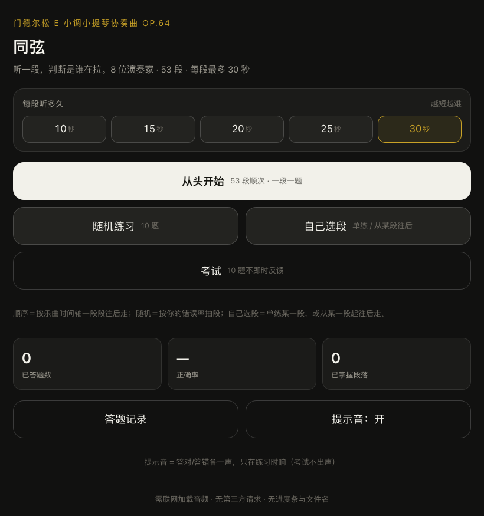
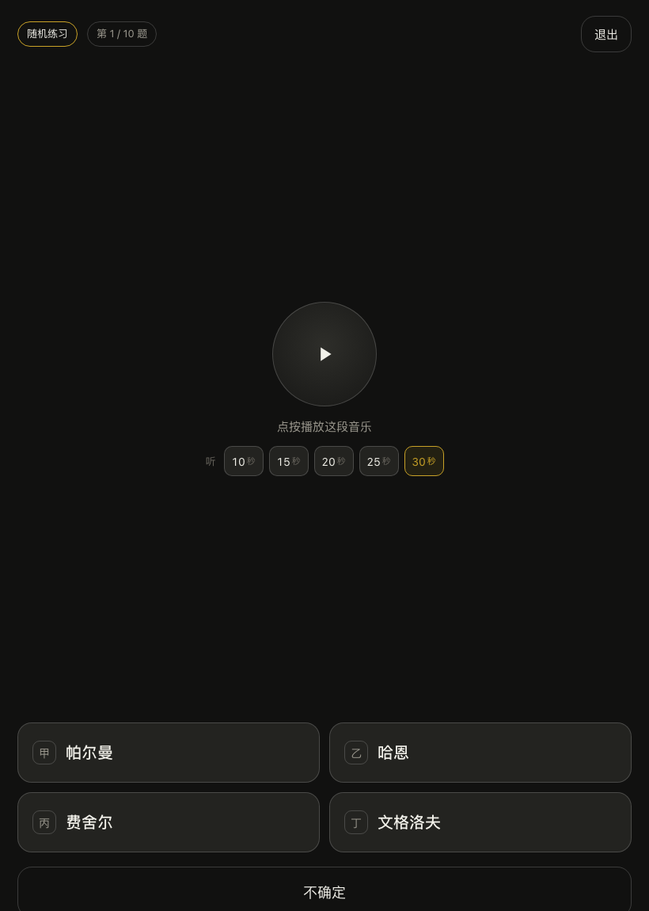
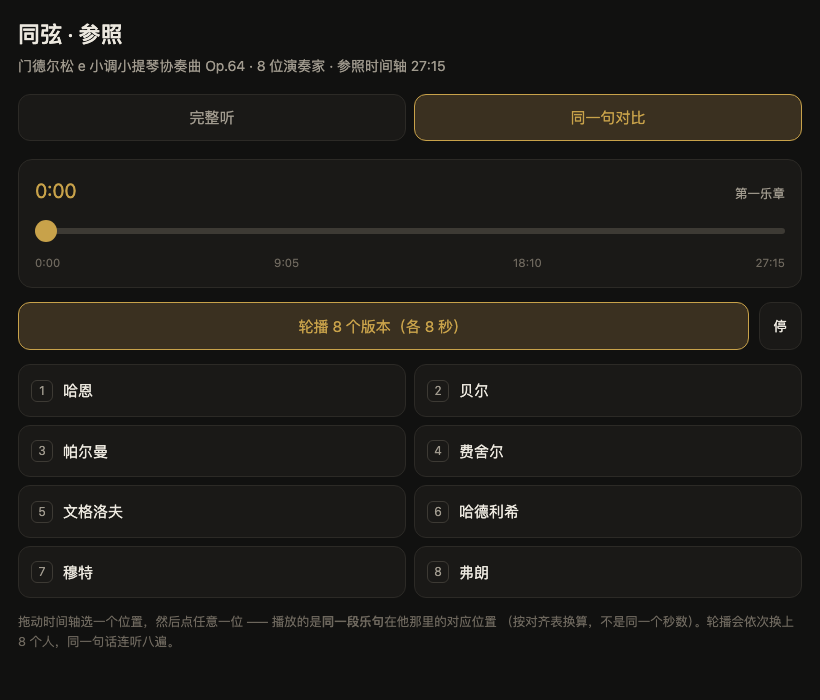
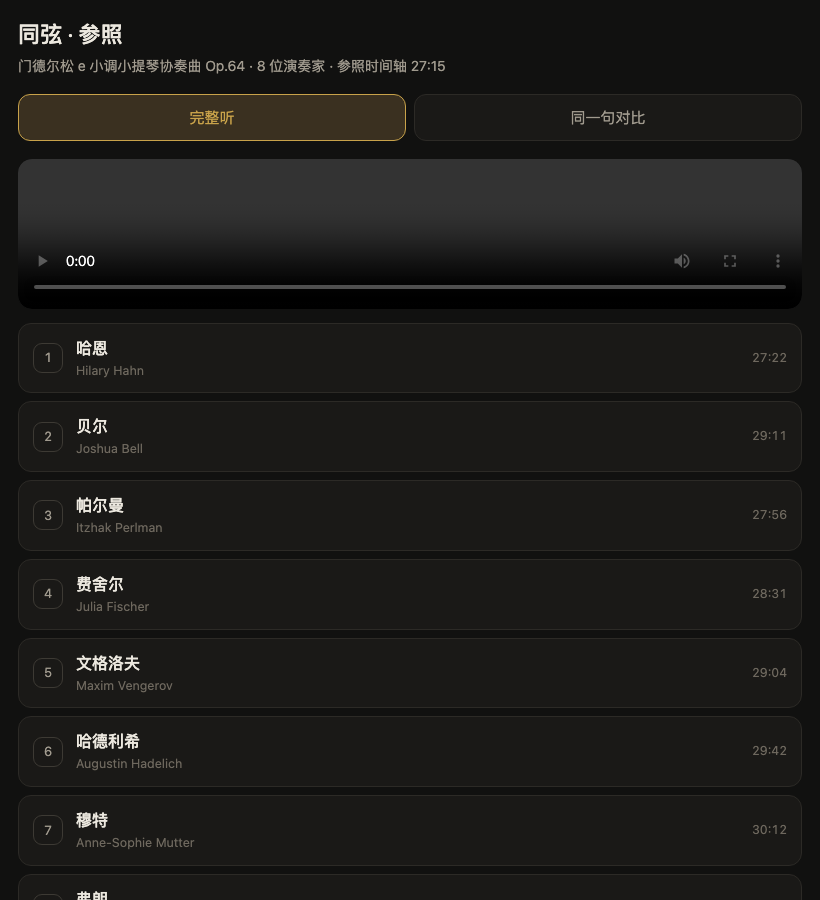

# 同弦 / Same Strings

盲听辨人的小提琴听力训练器。8 位演奏家演奏同一首门德尔松 e 小调小提琴协奏曲 Op.64，
每题播放一段（默认 30 秒）的某个版本，四选一判断是谁在拉。

同一段乐句在不同人手里，揉弦的密度、换弓的棱角、句尾的收法都不一样。这个工具让你
在「不知道是谁」的前提下反复听同一段，靠耳朵建立区分度，而不是靠记忆叙事。

<p align="center">
  
  
  
</p>

## 走的是哪条路

不做「听整曲写赏析」，也不做「看谱选版本」。只有一件事：**把同一个乐句听八遍**，
逼迫注意力落到声音参数上——颤音频率、弓压的呼吸、换把时的滑音长度、句尾收得多干净。

之所以能这么做，前提是先把八个人的时间轴对齐（S2 的 DTW），对齐之后「第 9 分 30 秒」
对每个人才是同一句话。对齐质量直接决定这个工具有没有意义，所以验收里把它卡在
`meanCosSim ≥ 0.85`，实测最低 0.91。

## 怎么玩

**每段听多久**：10 / 15 / 20 / 25 / 30 秒。越短越难——短到 10 秒时只剩音色和发音方式
可抓，几乎没有乐句信息。默认 30 秒。

**四种开始方式**

| 入口 | 干什么 | 适合 |
|---|---|---|
| 从头开始 | 53 段顺次走一遍，一段一题，按乐曲时间轴 | 系统过一遍全曲 |
| 随机练习 | 10 题，按你的错误率抽段（错得多的段出现得更频繁） | 每天十分钟 |
| 自己选段 | 单练某一段，或**从某一段起往后走** | 只练再现部 / 接着上次断的地方练 |
| 考试 | 10 题，全程不给对错反馈，答完一起算 | 检验，而不是练习 |

「自己选段」里每段都标了时长与乐章分组；单段练习页底部另有「从这一段往后走 →」
快捷入口，不用退回列表重选。

**答题页**：中间圆钮播放，播放时随时可以在 10–30 秒之间改时长——改小到已经播过的长度
会立刻停，否则下一段生效，不用退出这一题。下面四个选项排成甲乙丙丁（随机取 4 位演奏家，
必含正确答案），底部是「不确定」。

**不确定**是有意设计的：它不计入正确率，也不改掌握度（格子不动）。听不出来时按它，
比瞎猜更接近真实进步——瞎猜对了会给错误的信心。

**提示音**是练习模式专属，答对答错各一声。考试模式全程静音，否则音高本身就泄题了。

**掌握度**每段三格：答对进一格，答错**打回第一格**（不是退一格）。从 1 起算，
所以连着答对两次就到第三格 = 掌握。首页「已掌握段落」就是这个数。

## 两种打包形态

同一套源码、同一套管线，产物有两种形态。差异只在**音频怎么送到耳朵**。

| | `inline` | `static` |
|---|---|---|
| 产物 | 单个 `同弦.html`（约 23 MB） | `dist/site/`（index.html 91 KB + `audio/*.m4a` 148 MB） |
| 音频 | base64 内联进 HTML | 外置，按需 HTTP 取用（单次约 358 KB） |
| 分段数 | 受 25 MB 体积预算约束，8 位演奏家只能放 6 段 | 不受体积约束，可覆盖全曲（53 段 × 8 人 = 424 片段） |
| 分发 | AirDrop 一个文件到 iPad，双击即用 | 需要 Web 服务器（见下方 Docker） |
| 离线 | 可以，飞行模式照样答题 | 不行，断网就是用不了 |
| 首屏 | 解析 23 MB base64（约 46 MB 内存峰值） | 取一个几百 KB 的片段 |

改 `project.json` 的 `pack.mode` 切换。默认 `static`。

**为什么内联模式要有体积上限**：`file://` 协议下 Safari 不允许 fetch 同目录文件，
所以离线单文件只能把音频 base64 塞进 HTML，而 base64 膨胀 4/3。
25 MB 这条线的实质是「iPad 上页面不会被 iOS 因内存压力丢弃」，
不是磁盘配额。详见 `SPEC.md` S3.5。

## 快速开始

依赖：Python **3.11+**，外加两个可执行文件 `ffmpeg`（切片/归一化/重封装）和
`yt-dlp`（抓音轨）。Node 只在跑出题逻辑模拟（`tests/`）时需要，不是运行依赖。

```bash
brew install ffmpeg yt-dlp                 # macOS
python3 -m venv .venv
.venv/bin/pip install -r requirements.txt
.venv/bin/python build.py                  # 全流程 S0→S5，首次约 40 分钟（含下载）
.venv/bin/python build.py --verify-only    # 只跑验收
```

单阶段重跑：

```bash
.venv/bin/python build.py --only s3         # 只重算选段
.venv/bin/python build.py --from s3 --to s5 # 选段 → 切片 → 打包
.venv/bin/python build.py --force s4        # 忽略缓存强制重跑
```

每阶段用输入签名判断缓存，`project.json` 里改段数/时长会自动让下游失效。
签名覆盖的不只是「生成参数」，还有「真正被读的那个文件」的指纹——这条是踩出来的，
细节见 `build.py` 里 `_file_sig()` 的注释。

## Docker 部署（NAS）

分两步：本机产出站点，NAS 上构建运行。**构建（下载音轨、对齐、切片）永远留在本机** —— 它要
2.2 GB PCM 和几十分钟 CPU，塞给 NAS 只会把镜像撑到几 GB，而且每次改一个参数都要重来一遍。

```bash
.venv/bin/python build.py     # 产出 dist/site/（149 MB，424 个片段）
tools/nas_pack.sh             # 打成传输包 dist/nas/same-strings-nas.tar.gz
```

包里**有且只有**运行镜像需要的东西：`Dockerfile`、`nginx.conf`、`docker-compose.yml`、`.env`、
`dist/site/`，外加一个空的 `ref/`。`build.py`、`ssm/`、`web/`、`tools/` 都不带 —— 它们不参与
运行镜像，传上去只是让 160 MB 变成几百 MB，还得等。

### 在 NAS 上原生构建（推荐）

NAS 几乎都是 x86_64，原生 build 连交叉都不需要。为什么不在 Mac 上构建：这台机器上没有任何
容器运行时（`docker` / `podman` / `colima` 都没装），`tools/docker_pack.sh` 跑不起来。为了打一个
50 MB 的镜像去装一套虚拟机不划算。

```bash
# 传包。DSM 默认没开 SFTP，scp / rsync 走不通（报 "subsystem request failed"），
# 所以用 ssh 直通管道，走的是 exec 通道，不需要 sftp-server。
ssh nas 'cat > /volume1/docker/same-strings-nas.tar.gz' < dist/nas/same-strings-nas.tar.gz
ssh nas 'cd /volume1/docker && tar xzf same-strings-nas.tar.gz'

# 起容器。DSM 的 PATH 里没有 /usr/local/bin（非交互 shell 只有 /usr/bin:/bin:/usr/sbin:/sbin），
# docker 装在 /var/packages/ContainerManager/target/usr/bin，所以要么写全路径，要么先 sudo -i
ssh nas 'cd /volume1/docker/same-strings && sudo /usr/local/bin/docker compose up -d --build'
```

不想碰命令行就走 UI：**Container Manager → 项目 → 新增 → 选择现有 `docker-compose.yml`**，
指向 `/volume1/docker/same-strings/docker-compose.yml`，之后启停和日志都在界面里。

首次 build 会拉 `nginx:1.27-alpine`（约 20 MB），NAS 要能上网。

两个服务走两个端口，互不干扰：

| NAS 上的端口 | 容器内 | 是什么 |
|---|---|---|
| **25001** | 80 | 练习器（`dist/site`，打进镜像） |
| **25002** | 8081 | 参照页（`dist/ref`，从挂载目录读） |

```bash
http://<NAS 地址>:25001/     # 练习器
http://<NAS 地址>:25002/     # 参照页
```

端口和参照页目录都走 `.env`：

```
PORT=25001
REF_PORT=25002
REF_DIR=/volume1/docker/same-strings/ref
```

为什么拆成两个端口而不是 80 加 `/ref/` 子路径：参照页里的引用全是相对路径
（`video/xxx.mp4`、`audio/xxx.m4a`），挂在 `/ref/` 下就得额外维护
`/ref/video/`、`/ref/audio/` 两份 MIME 规则，和练习器的 `/audio/` 规则重复。
两处一旦漂移，症状是「只有某一个页面放不出声」，特别难查。现在是各自一个根，
`/video/`、`/audio/` 的规则全站只有一份。

`nas_pack.sh` 写在包里的 `.env` 用的是相对路径（`REF_DIR=./ref`）—— 解压目录自己就是项目根，
参照页就在旁边，不用改任何绝对路径就能起。

包里的 `.dockerignore` 排掉了 `ref/` 和 `.env`。这一条不能省：等 3 GB 视频拷进去之后，
不排除的话 `docker compose build` 会先把 3 GB 全发给守护进程，表现为「卡在
Sending build context 不动」，看起来像构建卡死。

### 可选：在 Mac 上交叉构建

如果哪天本机装了 Docker，也可以打成镜像传过去，省掉 NAS 上的构建：

```bash
tools/docker_pack.sh                       # 默认 linux/amd64
PLATFORM=linux/arm64 tools/docker_pack.sh  # 需要时也可以打 arm64
```

它会做四件事：预检 docker/buildx、`docker buildx build --platform linux/amd64 --load`、
**问镜像自己是什么架构**（不信任命令行参数）、导出成
`dist/docker/same-strings-amd64.tar.gz` 并打印 sha256。产物约 50 MB，传到 NAS 后：

```bash
gunzip -c same-strings-amd64.tar.gz | docker load
docker image inspect --format '{{.Os}}/{{.Architecture}}' same-strings:latest
```

架构断言这一步不是多此一举：交叉构建最常见的失败不是报错，而是**静默产出了宿主架构的
镜像**，一路部署上去才在 NAS 上炸。脚本直接 `image inspect` 比对，不一致就中止。

`docker-compose.yml` 里 `platform` 也默认 `linux/amd64`（`TARGET_PLATFORM` 可覆盖），
这样「构建出来的」和「跑起来的」是同一个架构。

导入镜像之后起容器用 `--no-build`，否则 compose 会想再 build 一次：

```bash
REF_DIR=/volume1/docker/same-strings/ref docker compose up -d --no-build
```

### 参照页挂载（可选）

参照页的 3.1 GB 视频**不进镜像**，而是从宿主机目录挂成参照页服务的**根目录**
（`/usr/share/nginx/html/ref`，也就是 25002 那个 server 的 `root`）：

```yaml
volumes:
  - "${REF_DIR:-./dist/ref}:/usr/share/nginx/html/ref:ro"
```

这样改视频、换画质都不用重新 build 镜像。3.1 GB 怎么上去：

```bash
# 同样走 ssh 管道（DSM 没开 SFTP，scp/rsync 都不通）
tar --no-xattrs -C dist -cf - ref | ssh nas 'tar -xf - -C /volume1/docker/same-strings'
```

`--no-xattrs` 不是可选项：不加的话每个文件都会带 `LIBARCHIVE.xattr.com.apple.provenance`
这样的 pax 扩展头，NAS 上的 GNU tar 不认，解压时刷几十行
`Ignoring unknown extended header keyword` —— 全是红字，但文件其实是好的。

挂上之后：

| 地址 | 是什么 |
|---|---|
| `http://<NAS>:25001/` | 练习器（`dist/site`，在镜像里） |
| `http://<NAS>:25002/` | 参照页（来自挂载目录） |

两个细节值得知道：

- **参照页单独占一个端口，所以它是根路径**，页面里 `video/xxx.mp4` 直接解析成 `/video/…`。
  早先挂在 `/ref/` 子路径时，少写一个结尾斜杠就会解析到上一级、全部 404 ——
  现在这个坑从结构上消失了。
- **参照页的 `location /` 用 `=404` 而不是回落到 `index.html`**。挂载目录漏了的时候，
  回落会让根路径静默返回一个空壳，看起来像「参照页坏了」，其实是「没挂载」。

不想用参照页就删掉 compose 里那段 `volumes` 和 `25002` 那行端口，练习器照常工作
（不会因为「参照页没挂」而连带 404）。

`nginx.conf` 里有三件事是必须的，改的时候别动：

1. **`.m4a` 必须是 `audio/mp4`**。nginx 自带的 mime.types 不一定收录 m4a，
   漏了就退回 `application/octet-stream`，iOS Safari 直接拒绝播放。
2. **支持 Range / 206**。Safari 打开音频会先发 Range 探测再续取，
   只回 200 全量会表现为「点了播放没反应」。
3. **不要 gzip m4a**。AAC 已经压过，二次压缩会破坏 Range 分段。

视频同理，只是换成了 `video/mp4`——iOS 对 `<video>` 的 MIME 比 `<audio>` 更挑，
落到 octet-stream 会一直转圈不出画面。所以 `/ref/video/` 和 `/ref/audio/` 各有一份声明。

⚠️ 改 `nginx.conf` 时注意 `add_header` 的继承规则：**子块里只要出现一个 `add_header`，
就不再继承父级的任何一个**。所以 `location /audio/` 那里必须自己再声明一次缓存策略，
否则会意外继承不到 `Cache-Control: no-cache`。

内网 http 通常可以直接播（Safari 不受 ATS 约束）。若被企业策略拦，再配 HTTPS。

## 参照页（dist/ref）

练习器是**考**你的，参照页是**教**你的。两份产物，用途相反。

<p align="center">
  
  
</p>

```bash
.venv/bin/python tools/fetch_ref.py        # 下 8 个原视频（H.264，取各源最高分辨率）
.venv/bin/python tools/make_ref.py         # 生成 dist/ref/
.venv/bin/python tools/check_ref.py        # 自洽检查（换算表 / faststart / 数据一致）
.venv/bin/python tools/serve.py 25002 ref  # 起服务，iPad 打开 http://<Mac IP>:25002/
```

`fetch_ref.py` 是幂等的：先问 yt-dlp「这个源最高给到多少」，再和本地已有文件比对，
不达标就重下、达标就跳过。所以反复跑不会浪费时间，也不会降级。
`--dry-run` 只打印计划，`--force` 无条件重下。

`check_ref.py` 盯的是**看不出来的错**：拖到 9:30 之后八个人各播八秒，听着都像那么回事，
但某个人可能偏了十几秒。它逐点比对页面里嵌的换算表和 `work/warp/*.json` 是否一致
（防止把旧表打进新页面）、检查表单调不减、确认每张表的末端没超出该人音轨
（超了 seek 会被浏览器夹到末尾，听感是「卡住」）、以及视频确实做了 `+faststart`。

两块内容：

- **完整听**：8 位演奏家的完整视频，点谁播谁。看运弓、揉弦、身体律动。
  有的录像开头是一段**静场**（就位、观众入场），最长的到 34 秒——点开听不到声音，
  很容易以为坏了。所以构建期会实测每位的「音乐起点」，点开时自动跳过并提示跳了多少，
  想从第一帧看就把进度条拖回 0:00。实测：哈德利希 18 s、文格洛夫 32 s、穆特 34 s，
  其余六位一开就有声。
- **同一句对比**：拖时间轴选一个位置，点任意一位 —— 播的是**同一段乐句**在
  他音轨上的对应位置。这里用的是 S2 的 warp 表做换算，不是同一个秒数：
  第 9 分 30 秒在哈恩那里可能落在 9 分 33 秒，在穆特那里是 9 分 26 秒。
  点「轮播」会把 8 个人依次换一遍，同一句话连听八遍。
  - **每次听几秒**：4 / 6 / 8 / 12 / 16 / 20 / 30 七档，默认 8 秒，选完记在本机
    （下次打开还是这个值），轮播按钮上也会跟着显示当前秒数。
  - **‹ › 按段跳**：按你选的秒数前后挪一格，而不是固定跳 30 秒 —— 步长和每次听的长度
    对齐，一段接一段往下捋时正好首尾相接。到两端会夹住，不会越界成负时间；
    轮播中手动挪段会先退出轮播，否则链路会错位。
  - 时间轴本身是**按秒**的（`max` = 总秒数、`step` 1 秒），不是 0–100 的百分比
    —— 百分比一格约 16 秒，太粗，‹ › 也就没法精确挪「你要的那几秒」。

对比用的音轨是从 `work/pcm/*.wav` 转的 96 kbps（已裁头、已统一响度），
不是视频里的音轨 —— 视频带片头掌声、响度各不相同，拿来对比反而干扰。

画质说明：源本身决定了上限，下载参数只能保证「拿到该源给得出的最高」。

| 演奏家 | 可拿到 | 说明 |
|---|---|---|
| 费舍尔、哈德利希、弗朗 | 1920×1080 | 有 1080p 的 avc1 流 |
| 哈恩、贝尔、文格洛夫 | 1280×720 | 源最高就是 720p |
| 穆特 | 720×480 | |
| 帕尔曼 | 672×378 | 老录像，源本身只有 378p |

一个踩过的坑：`bestvideo[ext=mp4]` 这类写法按**码率**排序，B 站的 HEVC 流码率低
分辨率高，结果经常拿到 HEVC 或干脆退到低分辨率的 avc1（费舍尔明明有 1080p 的
avc1 30080，默认排序给了 720p 的 30064）。正解是 `-S "res:1080,vcodec:h264"`：
按分辨率排序 + 锁 H.264。

尺寸上有个预期：`dist/ref` 合计约 3 GB（视频 2.9 GB + 对比音轨 159 MB），
所以它不进仓库、也不进 Docker 镜像。要在 iPad 上不依赖 Mac 也能看，
把它挂到 NAS 容器的 `/ref/` 就行（见上一节「参照页挂载」）。

## 管线

| 阶段 | 做什么 | 关键点 |
|---|---|---|
| S0 | 抓取 B 站音轨，分 P 拼接 | 拼接缝对齐误差 < 1 s |
| S1 | 响度归一化 + 头部对齐 | `loudnorm` 两遍法；裁掉各版本长度不一的掌声/静场 |
| S2 | 对齐到锚点时间轴 | 全局单调 DTW（chroma_cens），头部 60 s 用子序列匹配局部校正 |
| S2.5 | 生成左右声道对照音频 | 左耳锚点、右耳目标，人工核验对齐 |
| S3 | 选段 | `sequential` 从乐曲开头连续切，确定性、无随机 |
| S4 | 切片与编码 | 先切再压；段内做响度对齐，否则响度差会成为答题捷径 |
| S5 | 打包 | 按 `pack.mode` 输出内联 HTML 或静态站点 |

**不用子序列 DTW 做正式对齐**：再现部会匹配到错误位置，必须是全局单调。
**不降码率省体积**：64 kbps 会削掉高频泛音，而泛音正是分辨演奏家的关键信息。

## 验收

自动 16 项 + 人工 4 项，构建期打印，不达标非零退出。

| # | 自动项 | 实测（本轮） |
|---|---|---|
| 1 | 抓取完整性（分 P 拼接误差 < 1 s） | 0.000 s |
| 2 | 响度一致（极差 ≤ 0.5 LU） | 0.040 LU |
| 3 / 7 | 编码一致 + 段长全部 30.000 s | 1 种编码，偏差 0.33% |
| 4 / 4.1 | 对齐质量 `meanCosSim ≥ 0.85` + warp 单调 | 最低 0.914（mutter） |
| 9 | 页面体积 ≤ 300 KB（音频外置不计） | 90.6 KB |
| 10 | 无第三方域名引用 | 0 处 |
| 12 | 片段总数 = 8 × 段数 | 424 |
| 13 / 14 | 选项合法 + 答案均衡（1000 轮 × 10 题） | 异常 0 次 |
| 15 | 每位演奏家至少一个片段 | 全覆盖 |
| 16 | 顺序 / 从中间起 / 单段 / 时长预设 | 53 / 50 / 1 / 10–30 秒 |
| 17 | 切分从 0 s 起、递增不重叠 | 0, 30, … , 1590 s |
| 18 | 每个 clipId 都有对应文件，无残留 | 缺 0，多 0 |
| 19 | 音频总量（NAS 占用） | 148.1 MB |

协议层另有 `tools/smoke_site.py`：起一个支持 Range 的本地服务器，
验证 200 / 206 / `Content-Range` / `Accept-Ranges` / ftyp 头都对（11 项）。
界面层有 `tools/smoke_browser.py`：把断言注入页面副本，用 headless Edge 跑一遍
（顺序题数、从第 N 段起、模式切换、考试不反馈、禁用 localStorage 仍可答）。

人工项（自动验收覆盖不到）：

- **#5 对齐正确性**：`work/check/*.m4a` 左右声道对照，听 3 处
- **#6 选段质量**：`work/check/segment-s0*.m4a` 逐段试听（`python tools/make_listening.py 6`）
- **#8 联网可达**：真 iPad 上连续答 10 题
- **#11 存储降级**：关掉 Safari 网站数据后仍能答题

## 目录

```
SPEC.md          需求规格（唯一来源，先改它再改代码）
project.json     唯一人工编辑的配置：演奏家、切片参数、打包形态
build.py         构建入口，负责签名缓存与验收
ssm/             S0–S5 各阶段 + verify
web/             前端（logic.js 是纯函数，可被 node 直接测试）
tests/           出题逻辑的 1000 轮模拟
tools/           诊断、冒烟、参照页脚本（见下表）
docs/            README 用的截图
work/            中间产物（不入库：pcm 2.2 GB、feat 90 MB、src 原始音轨）
dist/            产物（不入库）
```

## 工具一览

`tools/` 下 13 个脚本，按用途分四类。都是独立可跑的，不依赖 `build.py`。

**诊断（怀疑对齐有问题时才用）**

| 脚本 | 回答什么问题 |
|---|---|
| `diag_clip.py` | 全局 `meanCosSim` 高但某一段听着不像？逐段看相似度，定位塌陷处 |
| `diag_offset.py` | 某一版整体偏了几秒？用子序列 DTW（只诊断，不参与正式对齐）量偏移 |
| `diag_span.py` | 两版速度比是多少？用 `(start, end)` 跨度与锚点跨度的比值算 |

**冒烟测试（改完前端或部署后跑）**

| 脚本 | 验证什么 |
|---|---|
| `smoke_site.py` | 协议层 11 项：200 / 206 / `Content-Range` / ftyp |
| `smoke_browser.py` | 界面层：把断言注入页面副本，headless Edge 跑一遍 |
| `smoke_audio.py` | 音频层：直接解码比对，不走 `<audio>` 实时播放（headless 下媒体时钟不推进，会假阴性） |

**参照页与素材**

| 脚本 | 干什么 |
|---|---|
| `fetch_ref.py` | 下 8 个原视频，幂等、按目标画质自愈 |
| `make_ref.py` | 生成 `dist/ref`（拼接分 P、重封装 `+faststart`、转对比音轨、注入 warp 表） |
| `check_ref.py` | 参照页自洽检查 24 项（含对比页控件） |
| `serve.py` | 本机预览（支持 Range），第二参数选 `site` / `ref` |
| `make_listening.py` | 生成人工试听包（每条依次是 8 位演奏家） |
| `resolve_meta.py` | 把 b23.tv 短链解析成 BV 号 / 时长 / 分 P / chapters，填 `project.json` 用 |

**部署**

| 脚本 | 干什么 |
|---|---|
| `nas_pack.sh` | 打 NAS 用的传输包 `dist/nas/*.tar.gz`（Dockerfile + conf + `dist/site` + `start.sh`），自动剔掉 macOS 元数据 |
| `docker_pack.sh` | 交叉构建 x86_64 镜像，导出 `dist/docker/*.tar.gz` 并校验架构（需要本机有 Docker） |

## 排查

**参照页里某位「没有声音」**：先在「同一句对比」里听同一位。那边用的是裁过头的
96 kbps 音轨，如果那边有声、只有「完整听」哑，就是录像开头的静场（最长 34 秒），
不是文件坏了；点开时会自动跳过。如果两边都没声，再查文件本身：
`ffprobe -select_streams a` 有没有音轨、`ffmpeg -v error -i x.mp4 -f null -` 有没有解码错误。

**点了播放没反应**：九成是 MIME 或 Range。先 `curl -I` 看 `.m4a` 的 `Content-Type`
是不是 `audio/mp4`，再 `curl -r 0-99` 看是不是 206。用 `tools/smoke_site.py`
一次能查完 11 项。

**能播但拖进度条要等半天**：音频/视频缺 `+faststart`（moov 在文件尾）。
`make_ref.py` 会重封装，`smoke_site.py` 会断言 ftyp 头。

**NAS 上容器起不来，日志报 `exec format error`**：镜像架构不对——在 Apple Silicon 上
直接 `docker build` 产出的是 arm64。用 `tools/docker_pack.sh` 打 amd64，
`docker image inspect --format '{{.Os}}/{{.Architecture}}'` 确认是 `linux/amd64` 再导入。

**改了配置但页面没变**：缓存签名没失效。看 `build.log` 里对应阶段是「命中」还是「执行」。
真不确定就 `--force s3 s4 s5`。

**首页说「需联网加载音频」但我想离线用**：那是 `static` 形态的如实标注。
换 `project.json` 的 `pack.mode` 为 `inline` 重新打包，但段数会降到 6 段。

**iPad 上答不了题 / 状态不保存**：Safari 隐私设置里禁用了网站数据。
前端有 try/catch 降级（内存里保存，刷新即丢），验收 #11 就是查这个。

**预览服务终端刷满 `BrokenPipeError`**：正常。播放器拿到够用的字节就 abort
剩余的 Range 请求，`serve.py` 已经把它静音了；如果还在刷，说明你跑的是旧版本。

**YouTube/B 站下载失败**：`yt-dlp` 更新很勤，先 `brew upgrade yt-dlp`。
另外注意 `yt-dlp -p` 是 `--password` 的别名，**不是**分 P 选择，
分 P 要用 `--playlist-items`（踩过：报 `account username missing`）。

## 已知取舍

- **切到点就停，不做淡出**。iOS 上 `HTMLMediaElement.volume` 是只读的，做不了。
- **考试模式不出提示音**。对/错是两种音高，等于把答案提前告诉耳朵。
- **static 形态没有离线**。这是换取「覆盖全曲」付出的代价，不是疏漏。
- **顺序模式一次 53 题**。全曲切了 53 段，一轮走完确实长；中途可以「退出」，
  也可以到「自己选段」里只练某几段。
- **参照页不进镜像，但可以挂进去**。3.1 GB 视频塞进镜像没有意义（每次 build 都要重传
  一遍），所以走 `volumes` 挂到 `/ref/`：镜像 150 MB，视频换了不用重新构建。
- **音频不入库**。片段来自 B 站，版权属原演奏者与唱片公司；仓库只保留
  `project.json` 里的 bvid 引用，构建时现抓。
